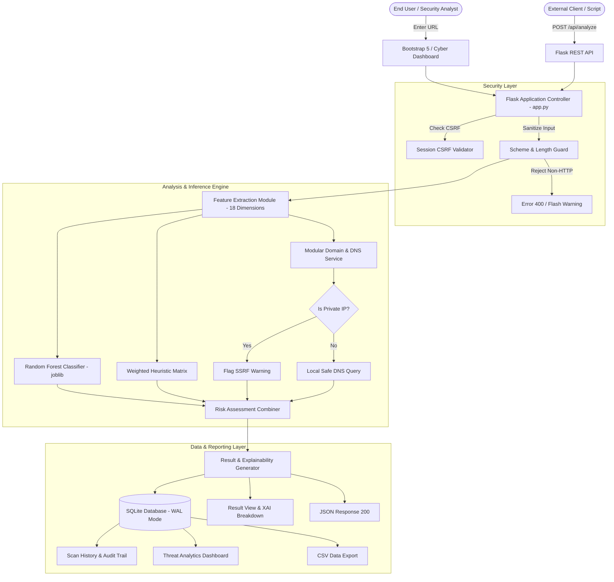

# System Architecture & Technical Specifications

## AI-Based Phishing Website Detection System

### 1. High-Level Architectural Flowchart



---

### 2. Module Decomposition

| Module Path | Responsibility | Primary Dependencies |
| :--- | :--- | :--- |
| `app.py` | Web routing, session CSRF token management, REST endpoints, view rendering | Flask, Jinja2 |
| `config.py` | Central configuration, environment variables, security thresholds | Python os, pathlib |
| `src/feature_extraction.py` | Lexical, structural, and semantic URL token parsing and signal definitions | urllib.parse, re, ipaddress |
| `src/prediction.py` | Model caching, inference coordinator, feature alignment | joblib, numpy |
| `src/risk_assessment.py` | Composite risk scoring, decision categorization, actionable advisories | Pure Python math |
| `src/domain_checks.py` | Safe DNS query with socket timeout, RFC 1918 private IP defense | socket, ipaddress |
| `src/database.py` | Parameterized SQLite CRUD operations, audit history, aggregation queries | sqlite3, json, csv |
| `src/evaluation.py` | Metric calculations (F1, precision, recall, AUC, confusion matrix) | scikit-learn, matplotlib |
| `src/train_model.py` | Reproducible multi-model training and candidate selection pipeline | scikit-learn, pandas |
| `src/download_data.py` | Academic benchmark dataset acquisition and validation | urllib.request, pandas |

---

### 3. Database Schema

The system uses an embedded SQLite database (`phishing_detector.db`) configured with Write-Ahead Logging (`PRAGMA journal_mode=WAL`) for concurrent read/write isolation.

```sql
CREATE TABLE scans (
    id INTEGER PRIMARY KEY AUTOINCREMENT,
    submitted_url TEXT NOT NULL,
    normalized_url TEXT NOT NULL,
    hostname TEXT NOT NULL,
    prediction TEXT NOT NULL,               -- 'Predicted Phishing' | 'Predicted Legitimate' | 'Uncertain'
    risk_category TEXT NOT NULL,            -- 'Higher risk' | 'Lower detected risk' | 'Uncertain'
    risk_score REAL NOT NULL,               -- Composite score (0.0 to 100.0)
    model_probability REAL,                 -- Calibrated ML probability (0.0 to 1.0)
    warning_count INTEGER DEFAULT 0,
    dns_status TEXT DEFAULT 'Not checked',
    signals_json TEXT,                      -- Serialized JSON of all 18 signal explanations
    created_at TIMESTAMP DEFAULT CURRENT_TIMESTAMP
);

CREATE INDEX idx_scans_created_at ON scans(created_at DESC);
CREATE INDEX idx_scans_prediction ON scans(prediction);
```

---

### 4. Security Boundaries

1. **Zero Client Code Execution:** Submitted URLs are analyzed as passive strings. The system does not fetch web pages, render HTML, or execute client-side JavaScript.
2. **SSRF Neutralization:** The host DNS resolver is isolated with pre-resolution and post-resolution IP filtering. Domains resolving to `127.0.0.1`, `10.0.0.0/8`, `172.16.0.0/12`, or `192.168.0.0/16` are flagged and prohibited from outbound network queries.
3. **Cross-Site Request Forgery (CSRF):** All state-modifying requests (`POST /analyze`, `POST /api/scan/<id>/delete`, `POST /api/history/clear`) require a valid session CSRF token validated with constant-time string comparison (`secrets.compare_digest`).
4. **Input Size Enforcing:** URLs exceeding 2,048 characters and HTTP payloads exceeding 16KB are rejected to prevent Denial-of-Service (DoS) buffer exhaustion.
